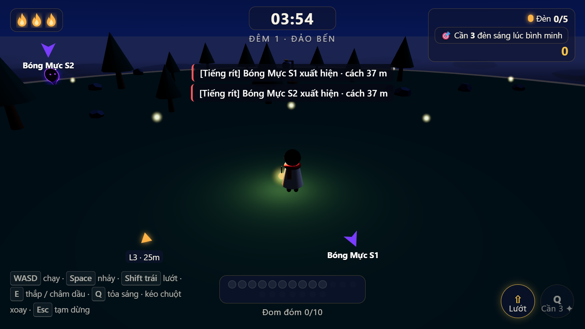
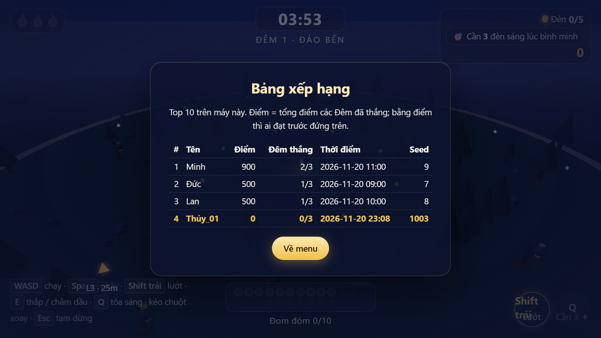
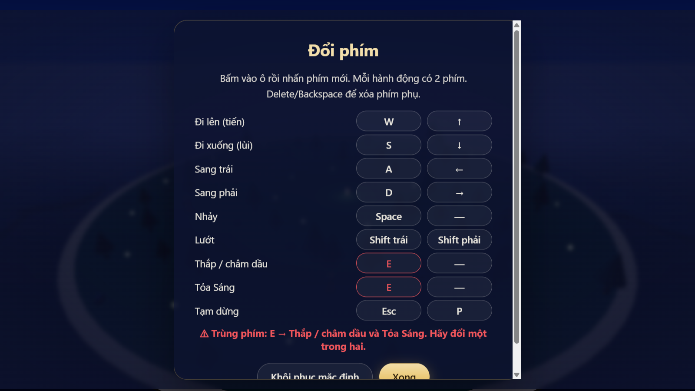
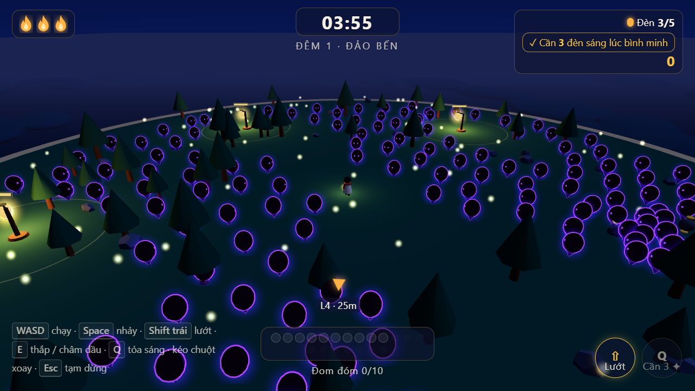

# Đảo Đèn Lồng — v1.0.0

> **🎬 Video demo v1.0.0 (2 phút 07 giây):** [demo.mp4 trên Release v1.0.0](https://github.com/dangkhuong14/K5-L3A-DAY12-MaiDangKhuong-2A202603627-AI-SDLC-Dao-Den-Long/releases/download/v1.0.0/demo.mp4) · trang Release: [v1.0.0](https://github.com/dangkhuong14/K5-L3A-DAY12-MaiDangKhuong-2A202603627-AI-SDLC-Dao-Den-Long/releases/tag/v1.0.0)

Game 3D góc nhìn thứ ba. Bạn là Mây, người giữ đèn nhỏ tuổi: gom đom đóm, thắp và giữ dầu cho các Đèn Lồng Lớn, né Bóng Mực trong sương đen cho tới bình minh, qua ba Đêm Đảo Bến → Đảo Cau → Đảo Chuông. Tự dựng bằng Three.js + TypeScript, bản desktop chạy bằng Electron. Luật chơi, thứ tự tick và giả định: [game/README.md](game/README.md).



| Bảng xếp hạng | Đổi phím, báo trùng | Cảnh benchmark 200 Bóng |
|---|---|---|
|  |  |  |

## Yêu cầu hệ thống

- Node.js 22.12+ hoặc 24 (kèm npm), Git. Windows 10/11, macOS 12+ hoặc Linux x64/arm64 có môi trường đồ họa.
- GPU hỗ trợ WebGL 2. Laptop có GPU rời: bản desktop tự xin GPU hiệu năng cao.
- ~600 MB đĩa cho `node_modules` (Electron chiếm phần lớn). Mạng khi `npm ci` lần đầu (npm tải Electron).
- Đã thử: Windows 11, Intel i7-9750H, GTX 1650 / UHD 630, 16 GB RAM (15.8 GB khả dụng), Node 24.14.

## Cài đặt và chơi (3 lệnh)

```sh
git clone <url-repo> && cd <thư-mục-repo>
npm ci
npm start
```

`npm start` build bản web rồi mở cửa sổ game 1280×720. Muốn chơi trên trình duyệt thay vì desktop: `npm run dev` rồi mở địa chỉ Vite in ra, hoặc `npm run build && npm run serve` → http://localhost:8080. Bản web lưu bảng xếp hạng trong `localStorage` của trình duyệt.

## Điều khiển

| Phím mặc định | Tác dụng |
|---|---|
| WASD / mũi tên | Chạy theo hướng camera |
| Space | Nhảy |
| Shift | Lướt |
| E | Nạp đom đóm để thắp / thắp lại / châm dầu đèn gần |
| Q | Tỏa Sáng (3 đom đóm, làm choáng Bóng trong 5 m) |
| Esc / P | Tạm dừng |
| Kéo / lăn chuột | Xoay / zoom camera |
| F3 · Enter | Hiện FPS · nút chính |

Mọi hành động đổi được ở **Cài đặt → Đổi phím** (báo trùng phím, có "Khôi phục mặc định"). Cài đặt còn có: âm lượng, độ nhạy chuột, bảng màu mù màu, phụ đề và chỉ báo hình ảnh, giảm chuyển động (tắt rung camera và chớp màn hình), chữ lớn ×1.25 (chữ thường tối thiểu 18 px). Tất cả được lưu.

## Lệnh

| Việc | Lệnh |
|---|---|
| Test (Phase 1–4) | `npm test` |
| Build web → `dist/` | `npm run build` |
| Headless (Test Contract) | `npm run --silent headless -- --seed 42 --night 1 --ticks 600 --out output.jsonl` |
| Benchmark → `bench.json` | `npm run --silent bench -- --seed 42 --duration 30 --out bench.json` |
| Soak 10 Đêm → `soak.json` | `npm run --silent soak -- --seed 7 --nights 10 --out soak.json` |
| Xuất bảng xếp hạng | `npm start -- --export-leaderboard out.json` |
| Bằng chứng Phase 4 | `npm run evidence:phase4` → `docs/proof/phase-4/<thời điểm>/` |

Lệnh contract nằm trong [game.contract.json](game.contract.json) (v1.3: `run_cmd`, `bench_cmd`, `soak_cmd`, `headless_cmd`).

- **Bench:** mở cửa sổ 1280×720 (không toàn màn hình), **vsync tắt** (`--disable-gpu-vsync --disable-frame-rate-limit`), cảnh chuẩn Đêm 1 với 200 Bóng `wander`, 100 đom đóm, L1–L3 sáng, camera bay vòng r 30 m · Y 15 m · 15 s/vòng; 3 s khởi động rồi đo đúng `--duration` giây, ghi `bench.json` và thoát mã 0. `peak_mem_mb` đo được (đỉnh tổng working set các tiến trình Electron). Kết quả trên máy làm bài: [bench.json](bench.json).
- **Soak:** 10 Đêm headless trong một tiến trình, input ngẫu nhiên theo seed; kết quả: [soak.json](soak.json).
- **Bảng xếp hạng:** sau khi thua bất kỳ Đêm nào hoặc sau màn Bình Minh, nhập tên 3–12 ký tự (chữ, số, `_`, chữ Việt có dấu). Bản desktop lưu ở thư mục dữ liệu ứng dụng (`%APPDATA%/dao-den-long/leaderboard.json` trên Windows, `~/Library/Application Support/dao-den-long/` trên macOS, `~/.config/dao-den-long/` trên Linux). Màn "Bảng xếp hạng" ở menu chính.

## Bản phát hành v1.0.0

Release GitHub `v1.0.0` đính kèm `dao-den-long-web-v1.0.0.zip`: thư mục web tĩnh đã build kèm `serve-dist.mjs`. Giải nén, vào thư mục `dao-den-long-web-v1.0.0` rồi chạy `node serve-dist.mjs . 8080` và mở http://localhost:8080 (trình duyệt chặn ES module khi mở `index.html` bằng `file://`). Bench, soak và export cần mã nguồn: làm theo 3 lệnh ở trên.

## Tài liệu

- [CHANGELOG.md](CHANGELOG.md) (4 phase, breaking changes), [CREDITS.md](CREDITS.md), [LICENSE](LICENSE) (MIT cho code của bài, không gồm tài liệu khóa học).
- Spec: [Phase 4](docs/09-PHASE-4-SPEC.md), [Phase 3](docs/08-PHASE-3-SPEC.md), [Phase 2](docs/07-PHASE-2-SPEC.md), [Phase 1](docs/02-SPEC.md). ADR: [docs/adr](docs/adr/).
- Kiểm chứng: [Phase 4](docs/verification/phase-4.md), [Phase 3](docs/verification/phase-3.md), [Phase 2](docs/verification/phase-2.md), [Phase 1](docs/verification/phase-1.md); bằng chứng thô trong [docs/proof](docs/proof/).
- Retro cả dự án: [docs/RETRO.md](docs/RETRO.md).
- Harness AI: [CLAUDE.md](CLAUDE.md), skill [.claude/skills/verify-game](.claude/skills/verify-game/SKILL.md), cấu hình preview [.claude/launch.json](.claude/launch.json).
- Video demo: Phase 1 trên [Google Drive](https://drive.google.com/file/d/1HBArRzjnTnL7LIKdRpBtpaduluiS4IZC/view?usp=sharing). Video v1.0.0: [demo.mp4](https://github.com/dangkhuong14/K5-L3A-DAY12-MaiDangKhuong-2A202603627-AI-SDLC-Dao-Den-Long/releases/download/v1.0.0/demo.mp4) đính kèm Release v1.0.0.

### Sáng tạo của tôi

Model low-poly tự dựng, nón lá treo đèn, biển mây và sao; lời dẫn Ông Đăng mỗi Đêm, màn Bình Minh, nhạc ngũ cung tổng hợp riêng mỗi Đêm, sóng Tỏa Sáng, tia lửa thắp đèn, sợi hút dầu, cây tự thu nhỏ khi che Mây. Chỉ ở lớp hiển thị, không đổi đầu ra headless và không thêm thực thể vào cảnh bench. Chi tiết: [game/README.md](game/README.md#sáng-tạo-của-tôi), ảnh: [docs/screenshots](docs/screenshots/), [docs/proof/phase-2/manual](docs/proof/phase-2/manual/).

---

## Hướng dẫn gốc của lab

> **Cá nhân** (1 người / 1 MSSV) · Áp dụng SDLC cùng AI để xây một **game 3D** qua **4 phase**, từ yêu cầu ban đầu tới bản phát hành.
> **Lab board + trợ giảng:** **[Đảo Đèn Lồng Lab](https://claude.ai/artifact/Q1RYyv1dxjUczzCbd2ZnoW)**

---

## Tài liệu của lab

| File | Nội dung |
|---|---|
| [GUIDE.md](GUIDE.md) | Hướng dẫn làm lab: vòng làm việc mỗi phase, harness, kiểm chứng, token |
| [CHECKPOINTS.md](CHECKPOINTS.md) | Các mốc tự kiểm tra từ chuẩn bị đến nộp bài |
| [SUBMISSION.md](SUBMISSION.md) | Đặt tên repo, hạn nộp, tag, Release, video, checklist |
| [RULES.md](RULES.md) | Quy định: AI, trung thực về bằng chứng, bản quyền, bảo mật |
| [RUBRIC.md](RUBRIC.md) | Thang điểm chi tiết |

## Lab board

Yêu cầu dự án được phát hành tại **[Đảo Đèn Lồng Lab](https://claude.ai/artifact/Q1RYyv1dxjUczzCbd2ZnoW)**. Mỗi phase là một tab (tab chưa phát hành bị khóa), mỗi tab có trợ giảng AI riêng chỉ trả lời trong phạm vi phase đó. Trợ giảng cần đăng nhập claude.ai và dùng lượt Claude của bạn.

## Dự án

**Đảo Đèn Lồng**: game 3D góc nhìn thứ ba. Mây, người giữ đèn nhỏ tuổi, gom đom đóm để thắp lại các Đèn Lồng Lớn và né Bóng Mực trong sương đen.

- Không ràng buộc công nghệ; chạy được trên macOS hoặc Linux.
- Tuân theo **Test Contract** (chế độ headless) để được chấm tự động và so sánh với nhau.

| Phase | Bạn nhận | Nộp |
|---|---|---|
| 1 | **PRD-0** (mô tả tổng quát) + Test Contract | tag `phase-1` |
| 2 | **Ticket-02**, phát hành khi Phase 1 kết thúc | tag `phase-2` |
| 3 | **Ticket-03**, phát hành khi Phase 2 kết thúc | tag `phase-3` |
| 4 | **Ticket-04**, phát hành khi Phase 3 kết thúc | tag `phase-4` + Release `v1.0.0` |

Yêu cầu sẽ được bổ sung và có thể thay đổi giữa các phase, giống dự án thật.

### Lịch 4 giờ

Bài lab kéo dài **4 giờ**. Phase 1 và 2 khoảng **1 giờ**, Phase 3 khoảng **30 phút**, Phase 4 khoảng **1 giờ 30 phút**. Mỗi phase phát hành đúng mốc giờ. Phase mới xuất hiện trên lab board khi tới mốc.

| Mốc | Sự kiện | Hạn tag |
|---|---|---|
| 0h | Phát hành **Phase 1** (PRD-0), gồm cả phần chuẩn bị | `phase-1` trước mốc 1h |
| 1h | Phát hành **Phase 2** | `phase-2` trước mốc 2h |
| 2h | Phát hành **Phase 3** | `phase-3` trước mốc 2h30 |
| 2h30 | Phát hành **Phase 4** | `phase-4`, Release `v1.0.0` và video trước mốc 4h |
| 4h | Hết giờ lab, chốt bài | |

Hết giờ mỗi phase thì tag và chuyển sang phase tiếp theo, dù phase chưa hoàn hảo. Chỗ chưa xong ghi trung thực trong bằng chứng.

---

## Gợi ý SDLC (cách làm là của bạn)

Mỗi phase là một vòng nhỏ. Công cụ, thứ tự, định dạng tài liệu đều tự do; đây chỉ là gợi ý:

1. **Requirements:** biến yêu cầu thành tiêu chí nghiệm thu kiểm chứng được. Chỗ mơ hồ thì tự giả định và ghi lại.
2. **Plan:** nghĩ cách kiểm chứng **trước** khi để agent viết code.
3. **Build:** để agent viết, bạn điều phối và review.
4. **Verify:** chạy thật, kiểm tra hành vi thật. *Không có bằng chứng thì chưa xong*: "agent bảo chạy rồi" không phải bằng chứng.
5. **Evaluate:** cái gì đạt, AI sai ở đâu, harness (AGENTS.md, skill, hook) cần chỉnh gì.
6. **Release:** gắn tag.

## Ba điều cần nhớ

> Bạn được **tự do sáng tạo thêm** quanh phần lõi (nhân vật, cơ chế nhỏ, câu chuyện, hiệu ứng, âm thanh…). Sáng tạo gọn và không phá yêu cầu được tính điểm trong hạng mục F của [RUBRIC](RUBRIC.md); ghi mục "Sáng tạo của tôi" trong README của bạn.

- **Game tốt là game đúng yêu cầu của khách hàng**, không phải game phức tạp hay đẹp nhất. Làm đúng và chứng minh được là đúng trước, trau chuốt sau.
- **Cân nhắc kỹ quota token của bạn.** Đốt nhiều token không làm bài tốt hơn. Ngữ cảnh gọn, kế hoạch rõ, kiểm chứng sớm thường vừa rẻ vừa đúng hơn chạy agent liên tục.
- **Kiểm chứng là phần quan trọng nhất.** Bằng chứng (test, output headless, ảnh, số đo) đáng giá hơn lời mô tả.

---

## Bàn giao cuối cùng

Một **repo GitHub cá nhân, public**, gồm:

1. **Toàn bộ mã nguồn** của game qua 4 phase, tag `phase-1` … `phase-4`, Release `v1.0.0`.
2. **Video demo `.mp4` dưới 5 phút** (đính kèm Release `v1.0.0` hoặc `docs/demo/demo.mp4`, link ở đầu README): chơi thử và cho thấy bằng chứng game chạy đúng.
3. **Bằng chứng kiểm chứng** của từng phase (định dạng tự chọn).
4. **Harness AI đã dùng** (AGENTS.md / CLAUDE.md, skills, hooks, plugins…), giữ nguyên trong repo và lịch sử git.
5. **Ghi chép ngắn:** spec/giả định mỗi phase, nhật ký dùng AI (gồm token/chi phí ước tính), retro.

Không commit API key, token hay `.env`. Gửi link repo theo hướng dẫn của Coach.

## Đánh giá (100 điểm)

| Hạng mục | Điểm |
|---|---|
| Test tự động ẩn (headless, gồm kiểm tra lại phase trước) | 30 |
| Kiểm chứng & bằng chứng của bạn | 20 |
| Quy trình SDLC & harness AI | 15 |
| Evaluation & retro (gồm cách bạn dùng token) | 10 |
| Hiệu năng & ổn định | 10 |
| Chất lượng sản phẩm (đúng yêu cầu, chơi được) | 10 |
| Video demo | 5 |

## Quy định

- Dùng AI thoải mái; không sao chép repo của người khác.
- Bằng chứng phải thật: test luôn đạt hay output sửa tay là vi phạm.
- Nhân vật, bối cảnh là bản gốc của lab; asset bên ngoài chỉ dùng loại CC0/CC-BY/MIT hoặc tự tạo, ghi nguồn trong `CREDITS.md`.
